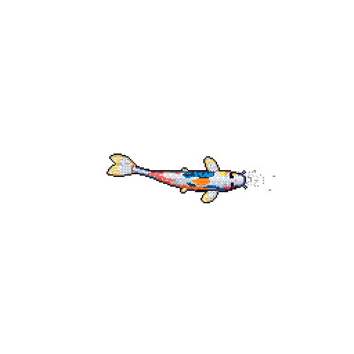

## 👋 Hello there!
## I’m Hrithik Bhattacharya — a student passionate about building, learning, and collaborating 🤝. I love teaming up with curious minds to create something meaningful and impactful 🌱✨.

## Currently exploring Machine Learning 🤖 and Full Stack Development 🧩, but I’m always open to trying out new things 🛠️🧠.

## Looking forward to collaborating with y’all 🚀💬!

  

    
  

<!--
**Hrithik-Bhattacharya/Hrithik-Bhattacharya** is a ✨ _special_ ✨ repository because its `README.md` (this file) appears on your GitHub profile.

Here are some ideas to get you started:

- 🔭 I’m currently working on ...
- 🌱 I’m currently learning ...
- 👯 I’m looking to collaborate on ...
- 🤔 I’m looking for help with ...
- 💬 Ask me about ...
- 📫 How to reach me: ...
- 😄 Pronouns: ...
- ⚡ Fun fact: ...
-->
